# Adaptive Traffic Signal Control with Deep Reinforcement Learning

<div align="center">

<!-- Render assigns the hostname on the first deploy. If yours differs, update the two
     links that point at it: the badge here and the one in the Live demo section. -->

<a href="https://adaptive-traffic-signal-control.onrender.com"></a>
&nbsp;
<a href="https://render.com/deploy?repo=https://github.com/Adityakumar1805/adaptive-traffic-signal-control"></a>

<sub>Free instance: if it has been idle for a while the first request takes about a minute to wake it (returning visitors see a "Waking up the server…" screen). Everything after that is real time.</sub>


<p>
  
  
  
  <a href="https://github.com/Adityakumar1805/adaptive-traffic-signal-control/actions/workflows/ci.yml"></a>
  
  
</p>

</div>

Four **Double + Dueling DQN** agents — one per junction of a 2 × 2 signalised grid — learn to
control the signals from what each junction can measure. Against a fixed-time controller they
cut average waiting time by **27 % at light demand and 71 % at rush hour**. Against
**max-pressure**, a strong adaptive rule, they are level at light and medium demand and
**9 % and 17 % ahead at high and rush demand** (ten seeds, with confidence intervals). A
safety finite-state machine makes conflicting greens impossible by construction. Emergency
vehicles are part of training, so the agents make way for an ambulance by themselves, and a
green-corridor rule on top gets it through the grid **4.4× faster** at rush hour.
It runs on **SUMO** when SUMO is installed and on a **built-in point-queue simulator** when it
isn't, and ships a live web dashboard that races the learned policy against the fixed-time
baseline on the same traffic, arrival for arrival — drawn as Indian traffic (two-wheelers,
autos, e-rickshaws, buses, tractors…) driving on the left, with ambulances, police cars and
fire engines you can send in yourself and follow, junction by junction, on both grids.

<p align="center">
  
  <br>
  <sub>The live page at rush hour. An ambulance is sent into both grids and the page plays in its automatic slow motion
  (0.2×) until it is through, then pauses on the result. In this run it needs 30 simulated seconds to get through the RL
  Agent System and 133 through the traditional one (1:43 sooner, 4.4× faster), which is also the rush-hour average of the
  emergency evaluation. Recorded with <code>tools/record_gif.py</code> and played 2.5× faster than recorded.</sub>
</p>

```bash
python run.py demo              # dashboard on http://127.0.0.1:8000 — nothing else to configure
```

---

## 🚀 Live demo

### **<https://adaptive-traffic-signal-control.onrender.com>**

No install, no SUMO, no checkpoint to train — the hosted instance runs the same shipped
model as the local demo. Three things worth doing in the first minute:

1. Watch the queues. The page opens at **Rush hour**: on the Traditional Traffic System
   (right) the queues outgrow the road — a `+15` badge counts the cars that no longer fit on
   screen — while the RL Agent System (left) keeps them short. The average wait sits in each
   map's header, and the live result under the maps says by how much the RL agents are ahead.
2. Press **Send emergency vehicle** and choose an ambulance, a police car or a fire engine.
   The same vehicle enters *both* grids, the race drops to slow motion so you can follow it,
   and it is tracked on both: circled, labelled *Moving*, *Waiting* or *Not moving*, the light
   it waits at ringed and its route ahead dashed. The line above each map says what it is
   doing on that grid, junction by junction, and the tracker under the maps says which system
   has it further along. Once it is through both grids the race pauses for a moment on the
   result — which system got it through faster, and by how much — and **Timeline** lists
   every step.
3. Press **Pause**, and use **⋯ → Step one decision** around a light change to see the 3 s
   amber and the 2 s all-red the safety layer inserts.

The status at the top right says **Live** while the WebSocket is up.

It is a shared simulation, deliberately: whoever else has the page open sees the same
race and can press the same buttons. Deployment details, the free-tier caveats and how to
host your own copy are in **[docs/DEPLOYMENT.md](docs/DEPLOYMENT.md)**.

---

## Measured results


Three controllers × five demand levels × ten seeds = **150 runs** on the built-in simulator,
every row in [`outputs/benchmark_results.csv`](outputs/benchmark_results.csv), aggregated in
[`outputs/benchmark_summary.md`](outputs/benchmark_summary.md). Average waiting time per
vehicle, in seconds:

| Demand | Fixed-time | Max-pressure | **RL agents** | RL vs fixed-time | RL vs max-pressure (95 % interval) | RL lower in |
|---|---:|---:|---:|---:|---:|---:|
| Low (arrival ×0.35) | 26.0 | **18.3** | 19.0 | −27.2 % | +0.6 ± 0.7 s | 2 of 10 seeds |
| Medium (×0.60) | 33.9 | 22.7 | 22.8 | −32.6 % | +0.1 ± 0.9 s | 6 of 10 |
| High (×0.90) | 70.1 | 33.9 | **30.9** | −56.0 % | **−3.0 ± 1.2 s** | 10 of 10 |
| Rush (×1.00) | 122.8 | 43.3 | **36.0** | −70.7 % | **−7.3 ± 2.7 s** | 10 of 10 |
| Surge (×0.36 → ×0.96 → ×0.36) | 40.6 | 25.8 | 25.1 | −38.2 % | −0.7 ± 0.9 s | 7 of 10 |

How to read it:

* **Against fixed-time** the agents are lower in every one of the 50 paired runs. The size of
  the gap at high and rush demand says as much about fixed-time as about RL: its east–west
  green is close to saturation there, so its queues grow without bound.
* **Against max-pressure**, the fairer yardstick, the agents win under congestion — by
  3.0 s at high and 7.3 s at rush demand, in every seed — and are level with it at low,
  medium and surge demand, where the interval of the difference includes zero. At low demand
  max-pressure is nominally ahead (18.3 s against 19.0 s). The project's claim is therefore:
  **RL matches a strong rule in light traffic and beats it under congestion.**
* **Surge** is the one time-varying scenario: within an episode the demand rises from light
  traffic to rush-hour level and falls back. The agents see each approach's arrival rate and
  its trend.

Queue length moves in step with waiting time, and at rush hour the agents complete 9.6 % more
trips than fixed-time. The full tables (queues, throughput, emergency clearance, seed-by-seed
comparison) are in the benchmark summary and in [REPORT.md](REPORT.md) §5.

<table>
<tr>
<td width="50%">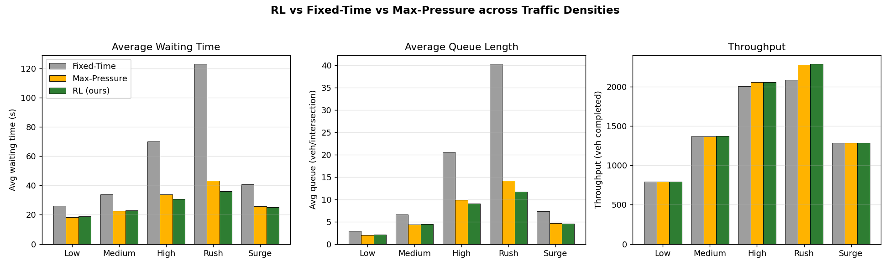</td>
<td width="50%">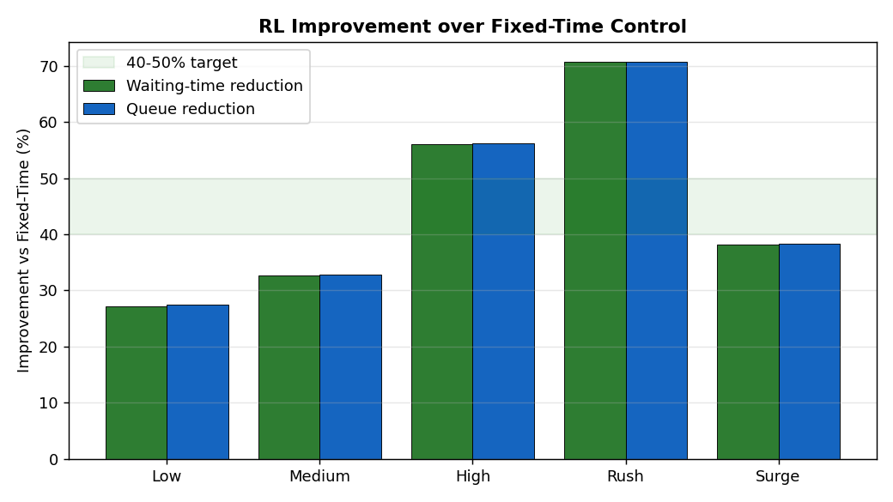</td>
</tr>
</table>

`python run.py eval` reruns all 150 episodes and overwrites both the CSVs and these plots.
The random seeds are fixed, so a rerun reproduces the table above rather than something
near it — [CI](.github/workflows/ci.yml) reruns it on every push, once with PyTorch and once
with the NumPy network the hosted site uses, and fails if a single byte of the CSVs changes.

### How much depends on the training run

One trained model is one draw. The same recipe was therefore trained five times (training
seeds 42–46). The shipped model is the one that was best on the **validation seeds 100–104**,
which are neither training traffic nor benchmark seeds: training seed 45. On the benchmark
seeds the five models give ([`outputs/study/model_study.md`](outputs/study/model_study.md)):

| Waiting time (s) | Low | Medium | High | Rush | Surge | Mean |
|---|---:|---:|---:|---:|---:|---:|
| Max-pressure | 18.3 | 22.7 | 33.9 | 43.3 | 25.8 | 28.8 |
| RL, shipped model (seed 45) | 19.0 | 22.8 | 30.9 | 36.0 | 25.1 | 26.7 |
| RL, mean of the five models | 21.0 | 23.8 | 32.3 | 37.9 | 26.3 | 28.3 |
| RL, lowest – highest | 19.0–22.7 | 22.3–26.1 | 30.7–33.6 | 36.0–40.7 | 25.1–28.5 | 26.7–29.9 |
| Models below max-pressure | 0 of 5 | 1 of 5 | 5 of 5 | 5 of 5 | 2 of 5 | 3 of 5 |

So the congestion result holds for every retrain, while the light-traffic result does not:
**the average retrain is 2.7 s behind max-pressure at low demand and 1.1 s behind at medium**,
and the shipped model is the best of the five at low demand. The same file has an ablation (one retrain each): removing
the demand inputs costs about 4 s at every demand level; removing the per-phase pressure
inputs or the emergency vehicles from training changes the mean by less than the spread
between retrains. `python tools/model_study.py` regenerates all three tables from the shipped
models, and CI checks that.

### The same benchmark on SUMO

`python run.py eval --backend sumo` runs the same 150 episodes on SUMO (1.18, libsumo). The
model was trained on the built-in simulator only and is used unchanged
([`outputs/sumo/benchmark_summary.md`](outputs/sumo/benchmark_summary.md)):

| Waiting time on SUMO (s) | Low | Medium | High | Rush | Surge |
|---|---:|---:|---:|---:|---:|
| Fixed-time | 21.1 | 26.4 | 45.3 | 53.9 | 30.5 |
| Max-pressure | 14.5 | 25.4 | 37.9 | 43.1 | 27.6 |
| **RL agents** | **11.7** | **15.1** | **22.1** | **25.5** | **16.8** |

On SUMO the agents are ahead of both baselines at every demand level and in every seed (about
20 % to 42 % below max-pressure), and they complete more trips. Three cautions before
reading much into that. The two simulators measure waiting differently: SUMO counts the time
a vehicle stands still, and a vehicle that cannot enter because its entry road is full is not
counted until it does, which flatters a controller that leaves the entries blocked (the
baselines here, not the agents). The max-pressure rule is used as it is, switching whenever
the other phase has more pressure; on SUMO every switch also costs acceleration time, which
is a likely reason it does worse there than in the point-queue model. And SUMO is not part of
CI, so these files are reproduced by hand (two runs here gave identical files). The headline
numbers of this project remain the built-in simulator's.

### Emergency vehicles, type by type

`python tools/emergency_eval.py` sends each emergency type — the ambulance and the fire engine
along the east–west arterial, the police car down the north–south side street — into the
traffic of both controllers at 25 moments of each of 50 episodes (five demand levels × seeds
0–9), every time into its own copy of the running simulation: 1,250 matched dispatches per
type. Pooled over every demand level, travel time through the grid:

| Vehicle | Fixed-time, stop-line rule | RL agents on their own, no rule | RL + green corridor (shipped) | RL + corridor: faster / tie / slower |
|---|---:|---:|---:|---:|
| Ambulance | 60.1 s | 26.7 s (−55.6 %) | **23.8 s** (−60.5 %) | 88 / 4 / 9 % |
| Police car | 24.8 s | 25.4 s (+2.3 %) | **21.6 s** (−13.0 %) | 59 / 10 / 31 % |
| Fire engine | 62.3 s | 28.5 s (−54.2 %) | **25.7 s** (−58.7 %) | 88 / 3 / 10 % |

Two things are being measured, and the table keeps them apart:

* **What the agents learned.** Emergency vehicles are dispatched during training with no
  rule attached; the reward pays for getting one through and charges for holding it, and the
  observation flags the approach it is on or heading for. With no preemption rule at all the
  agents get the ambulance and the fire engine through in less than half of fixed-time's
  time — nearly as fast as with the corridor rule. They do **not** do that for the police
  car: on the side street it is 2 % slower than under fixed-time, because the agents give the
  side street less green than fixed-time's even split.
* **What the shipped system does.** On top of the agents the RL grid clears a green corridor
  (every junction still ahead of the vehicle requests its phase from the moment it is sent);
  fixed-time pre-empts at the stop line, as a stand-alone signal would. With it every type is
  faster on the RL grid at every demand level. For the police car that lead comes from the
  rule, not from the learned policy, and it depends on the two grids being pre-empted
  differently (see [Known limitations](#known-limitations)).

The tables by demand level, the pass/fail check and the per-type charts are in
[`outputs/emergency/emergency_results.md`](outputs/emergency/emergency_results.md); every
dispatch is a row of `outputs/emergency/emergency_dispatches.csv`.

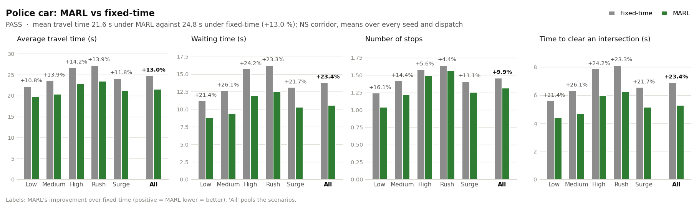

---

## The dashboard

One page, the same four junctions twice, the same arrivals fed to both: the learned policy on
the left (*RL Agent System* on the page), the fixed-time controller on the right
(*Traditional Traffic System*). The page is written for people with no traffic or
machine-learning background. The two maps fill the screen, each with a line on top that says
what is happening on that grid; everything else is under them — the emergency tracker, the
live result, a chart of the run and three small tiles. It opens at rush hour, where the
difference between the two systems is largest.

![The whole page on a 1440-pixel-wide screen, paused on the result of an emergency test: the title and live status (paused on the result, 3 s), the controls in one row, the two 2x2 grids side by side with the average wait in each header and a line saying the ambulance is through in 0:26 on the RL grid and 2:32 on the traditional one; under them the tracker (RL Agent System got it through 5.8 times faster, 2:06 sooner), the live result (33.2 s against 74.3 s, 55 percent less waiting), the chart of the run, and the tiles for cars queued, trips completed and the emergency test](docs/screenshots/dashboard_desktop.png)

| Control / panel | What it does |
|---|---|
| **The two maps** | The race itself. Each map's header gives that system's average wait at red lights; the line under it describes the system, or — while an emergency vehicle is on the road — says where that vehicle is on this grid (see below). On a laptop the maps are as big as the screen allows |
| **Pause / Play · Restart** | Freeze or resume the run; Restart replays the same traffic from the start |
| **Traffic** | Light / Normal / Heavy / Rush hour / Surge (the `low` / `medium` / `high` / `rush` / `surge` scenarios) — restarts the run with those arrival rates; Surge rises from light traffic to rush-hour level around minute 10 and falls back. The page opens at Rush hour; the busier the roads, the bigger the difference |
| **Speed** | A slider with six stops: 0.2× *very slow*, 0.5× *slow*, 1× *normal* (one 5 s decision per 200 ms tick, 25× real time), 2×, 4×, 8× *fastest* |
| **Send emergency vehicle** | Opens the choice — ambulance (east–west), police car (north–south) or fire engine (east–west) — and sends it into *both* grids at once (**E** opens the same menu). A refused dispatch (four already on the road) is explained in a message |
| **Slow motion and the pause on the result** | While an emergency vehicle is on the road the race plays at 0.2× so it can be followed, and the status at the top says *Slow motion until it is through*; choosing a speed yourself turns that off. Once a vehicle is through both grids the race stops for 5 s on the result, then carries on by itself (**Play** carries on at once) |
| **Live result** (under the maps) | Which system is ahead and by how much — *The RL Agent System is cutting waiting time by N%*, *The Traditional System is ahead right now, by N%*, *Both systems are about even right now*, or *Measuring the first two minutes…* — from the two average waits shown under it, and one sentence in seconds. The numbers describe the run on screen (one seed, still running), not the three-seed benchmark quoted under them: at rush hour the traditional system's queues keep growing, so the figure climbs over the 30-minute run |
| **Chart** | Waiting time or cars queued over the run so far; the area between the lines is shaded where the RL agents are ahead ("time saved by RL"); hover for the exact values at any minute |
| **Tiles** | Cars queued per junction as two bars on one scale, trips completed, and the result of the last emergency test with a link to its timeline |
| **⋯ More** | *Step one decision* (5 simulated seconds), the vehicle types on the road with live counts, and the technical details (model file, network, build, connection) |
| **? · ⛶** | How to read the page and the keyboard shortcuts; presentation mode (full screen) |

### Following an emergency vehicle

The question a viewer asks is simple — *is the ambulance moving, and where is it?* — so the
page answers it on the maps and in words, for every emergency vehicle on the road:

* **On both maps** it is circled by a pulsing ring with a label: *Ambulance · Moving*,
  *Waiting 0:12*, *Not moving 0:45* (no progress for 30 simulated seconds) or *Through in
  0:42*. The signal it waits at (or drives towards) is ringed in the colour it is showing, its
  route ahead to the edge of the grid is dashed with a ring on every stop line it still has to
  cross, a fading trail shows where it has just been, and the rest of the map is dimmed so it
  stands out (**Focus**, or **F**). Every junction pre-empted for it is outlined: on the RL
  grid that includes the junction ahead, which starts switching the moment the vehicle is
  sent; on the traditional grid only the one it waits at. When it leaves the grid, a *Through in 0:42* marker stays
  for ten seconds where it left.
* **Never lost from sight.** At rush hour a queue can hold more vehicles than the road on
  screen; a vehicle that waits too far back to be drawn — or drives onto a link already full
  of queued cars — is marked by a dashed ring on that queue's `+n` badge, and its label gives
  its place: *Ambulance · 18th in line · Moving*.
* **The line above each map** says the same in words, without scrolling: the status
  (*MOVING*, *WAITING 0:12*, *NOT MOVING*, *THROUGH*), the reason (*Green at J1_0 · 17
  vehicles ahead, clearing*, *Red light at J1_1 · first in line*, *Green requested at J1_1*,
  *Driving to J1_1*) and how far along its route it is (*Junction 1 of 2*).
* **The tracker** under the maps says which system has it further along (*RL Agent System is
  ahead · 1 junction further along (past J1_0)*) and has one row per grid: the status, the
  reason, the junction counter, a progress bar along its route with the junctions it has
  crossed, the time since it was sent and the time it has stood in queues. Once it is through
  both grids it says which system got it through faster and by how much (*RL Agent System got
  it through 5.8× faster · 2:06 sooner*), and it stays until you close it. **Timeline** (or
  **T**) lists every step with its time: sent, waiting at J1_0 and how far back, green
  requested, green light, crossed, out of the grid.

Every one of these facts comes from the simulator, not from the picture: the server sends,
for every emergency vehicle, the junction it waits at, its place in that queue (even beyond
what the browser is sent to draw), the link it drives on, its waiting time and age, and the
exact time it took to leave the grid; `tests/test_emergency_tracking.py` checks this feed
against the simulator at every frame and `tests/test_tracker_js.py` runs the page's tracker
in Node on a recorded rush-hour run and checks, frame by frame, that it places each vehicle
where the simulator has it, names the grid where it is further along and reports the
simulator's own clearance times. The tracker follows the frame the maps are showing, so the
words always match the picture.

<table>
<tr>
<td width="62%">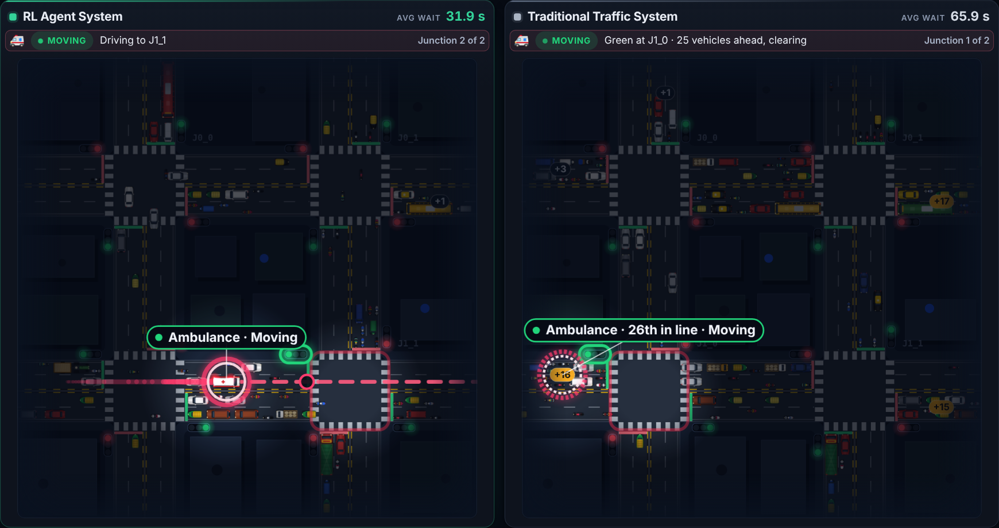</td>
<td width="38%">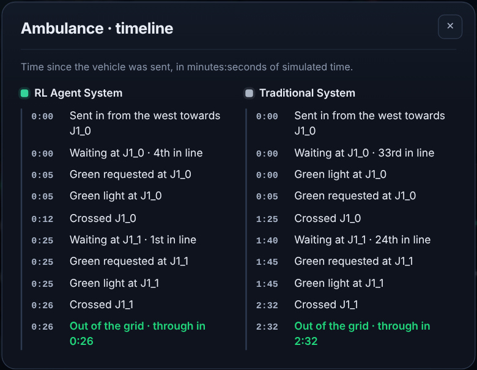</td>
</tr>
<tr>
<td colspan="2">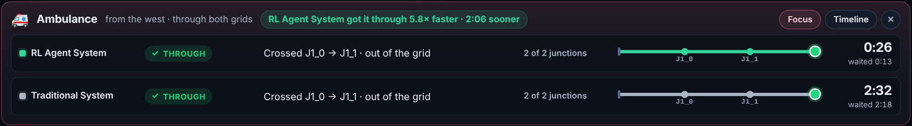</td>
</tr>
</table>

Colour means one thing each: green is the RL Agent System (and "better"), grey the
traditional system, rose emergencies; status dots are green (moving), amber (waiting) and red
(not moving); the lamps on the maps keep their real red, amber and green. The page is dark,
works with a keyboard alone (**Space** pause, **R** restart, **E** emergency vehicle, **F**
focus, **T** timeline, **?** help), and keeps its pulses, trails and beacons still under
*reduce motion*.

**What is drawn is exactly what is simulated.** Each vehicle has a kind from a configurable
Indian traffic mix (`traffic_mix` in `config.yaml`: about half two-wheelers, then cars,
autos and e-rickshaws, a few buses, trucks, tempos and tractors). Kinds are cosmetic — they
come from their own random stream, so changing the mix never changes the traffic or a
published number. The browser receives the moment every vehicle leaves a queue and enters
a link, and from those it reconstructs every queue, every vehicle on a link and every
vehicle crossing a junction for any instant between two frames; a test checks that this
reconstruction equals the simulator's real state second by second. Vehicles keep to the
left, slow vehicles to the kerb lane, two-wheelers pair up in a lane, and emergency
vehicles flash.

<details>
<summary><b>How the page talks to the server</b></summary>

* One WebSocket, `/ws`. The server sends a `hello` (geometry, vehicle catalogue,
  scenarios) and then one frame per 200 ms tick: a *keyframe* (full state) every 10 s or
  after a reset, otherwise a *delta* with only what changed — about 0.7 KB at medium 1×
  and 4 KB at rush 8×, against 8–11 KB for the full state.
* A heartbeat every 2 s while paused, a ping every 15 s, a 7 s watchdog, and reconnection
  with exponential back-off (0.5 s → 15 s, with jitter). A viewer that falls 25 frames
  behind is resynchronised with a keyframe instead of being sent a growing backlog.
* If WebSockets are blocked on the visitor's network, the page falls back to polling
  `/api/state` once a second (the status reads **Live · polling**) and keeps retrying the
  socket.
* Emergency vehicles have three fields of their own: `ed` (each dispatch: the same vehicle's
  id on both grids, its kind, when it was sent and the junctions on its route), `ev` (where
  each one is: queued at which approach and how far back, or on which link) and `evx` (the
  ones that have left, with the exact time it took). They are sent only when they change, and
  `am` says when the server is in its automatic slow motion or pausing on a result.
* A service worker caches the page so that a returning visitor sees **Waking up the
  server…** while a sleeping free instance boots, instead of a blank tab. It is network-first,
  so it never serves stale code while the server answers.
* Without FastAPI the project falls back to a zero-dependency standard-library server that
  serves the same page and polls.

</details>

<p align="center">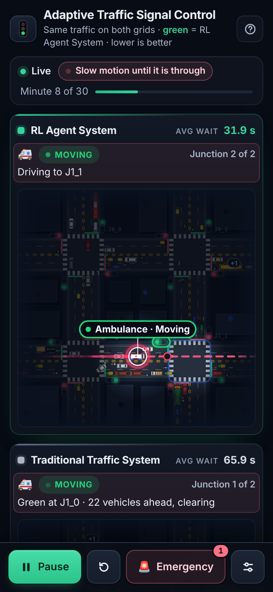</p>

On a phone the two grids sit one under the other, each with its own line, and the controls
move to a bar at the bottom; **Emergency** opens the same choice of vehicle.

---

## Fixed-time vs the learned policy

Both grids of the dashboard (*RL Agent System* and *Traditional Traffic System* on the page) receive
the *same* arrivals from the same seed, so every difference you see is the controller and
nothing else.

| | Fixed-time baseline | RL agents |
|---|---|---|
| Decides by | a clock: 30 s of NS, then 30 s of EW, forever | a 33-number observation, re-read every 5 s |
| Sees | nothing | its own 4 queues and waits, its phase, green-so-far, 4 emergency flags, its neighbours' pressures and phases, the pressure of each of its phases, and the arrival rate and trend on each approach |
| Coordinates | not at all | through the neighbour features — no central controller, no message passing |
| Reacts to a surge | on the next scheduled turn | on the next 5 s decision, and it sees the arrival rate rising before the queue has formed |
| Reacts to an ambulance | stop-line preemption: a junction switches once the vehicle waits at it | learned: emergency vehicles are part of training, and the flags show one waiting or on its way. On top, a green-corridor rule: every junction still ahead of the vehicle requests its phase from the moment it is sent |
| Waiting time at rush | 122.8 s | **36.0 s** |
| Code | [`control/fixed_time.py`](src/atsc/control/fixed_time.py) | [`control/rl_controller.py`](src/atsc/control/rl_controller.py) + [`agents/net.py`](src/atsc/agents/net.py) |

What the two share is the part that must not be negotiable: **both** drive the same safety
FSM, so both pay the same 3 s amber and 2 s all-red, and neither can produce a conflicting
green. The agents are not allowed to win by cheating the interlocks: a green lasts 10 to 60 s
whatever the controller asks, a change that has begun always completes, and no direction
waits more than 70 s for its green (60 s of the other green plus two 5 s clearances).

A third controller, **max-pressure**, is in the benchmark but not on the dashboard. It is the
stronger baseline: level with the agents in light traffic, behind them under congestion — the
results section above gives the numbers.

---

## Technology stack

| Layer | Choice | Fallback if absent |
|---|---|---|
| Learning | PyTorch 2.2 (Double + Dueling DQN, prioritized replay) | a from-scratch NumPy dueling net with manual backprop |
| Simulation | SUMO 1.18+ through TraCI | a built-in point-queue simulator behind the same interface |
| Web server | FastAPI + `uvicorn[standard]`, WebSocket push of compact deltas | `http.server` from the standard library, polling |
| Frontend | hand-written HTML, CSS and `<canvas>` JavaScript in ES modules; all 18 vehicle sprites drawn in code | — (there is no framework and no CDN to lose) |
| Numerics | NumPy 1.26, pandas + matplotlib for the benchmark plots | — |
| Config | one `config.yaml`, read by every module | — |
| Tests | pytest, 256 tests (environment, observation, safety FSM, reward, training, replay, controllers, config validation, emergency preemption and evaluation, benchmark maths and statistics, model study, wire protocol, servers, vehicles, page and emergency tracking), run by GitHub Actions on every push, and a Playwright browser check | — |
| Hosting | Render free plan, defined in [`render.yaml`](render.yaml) | the same [`Dockerfile`](Dockerfile) on Spaces / Fly / Railway |

Three of those fallbacks are load-bearing rather than decorative: the hosted site runs
**without torch**, on the NumPy network loading the same checkpoint, which is what keeps
it inside a 512 MB free instance.

---

## Quickstart

**Windows**

```bat
run.bat
```

**macOS / Linux**

```bash
./run.sh
```

The launcher creates a virtual environment, installs the pinned dependencies, loads the
shipped pre-trained checkpoint, starts the dashboard and opens
**http://127.0.0.1:8000**. SUMO is not required — the built-in simulator takes over
automatically and the launcher prints how to install SUMO if you want the microscopic view.

<details>
<summary><b>Manual and advanced usage</b></summary>

```bash
pip install -r requirements.txt

python run.py doctor         # environment and dependency check, prints what is missing
python run.py demo           # train-if-needed, then open the live dashboard
python run.py train --quick  # 8 episodes, under a minute on a CPU -> models/pretrained/atsc_2x2_quick.pt
python run.py train --overwrite  # full 400-episode curriculum (about 8 CPU minutes); REPLACES the shipped model
python run.py eval           # 150-run benchmark -> outputs/*.csv, summary and KPI plots
python run.py eval --backend sumo   # the same benchmark on SUMO -> outputs/sumo/
python run.py sim            # watch the trained policy in SUMO-GUI (needs SUMO)
python tools/emergency_eval.py      # every emergency type, RL vs fixed-time -> outputs/emergency/
python tools/model_study.py         # model selection, variation between trainings, ablation -> outputs/study/
python tools/make_results_svg.py    # redraw docs/assets/results.svg from the benchmark summary
pytest                       # 256 tests (without Node.js the browser-script tests skip themselves)
python tools/e2e_browser.py --local   # headless-browser check of the dashboard (needs playwright)
```

Every one of these reads `config.yaml`; the few flags above only choose *what* to run, and
any command accepts `--debug` to print a full traceback. A plain `train` refuses to
overwrite the shipped checkpoint (and the training log the README quotes) unless you pass
`--overwrite`.

</details>

---

## How it works


One loop, five stages, and a closed feedback path. `config.yaml` is the only source of
numbers. The simulator is either SUMO through TraCI or the built-in point-queue model behind
the identical interface. Every 5 s of simulated time each junction produces a 33-number
observation, its agent asks for a phase, the safety layer decides whether that request is
legal, and the lamp state it produces is what advances the simulation to the next decision.

### What one agent computes


33 numbers in, 2 Q-values out, **21,251 parameters** in total. The observation is 4 queue
lengths + 4 waiting times + a 2-way phase one-hot + green-time-so-far + 4 emergency flags +
4 neighbour pressures + 4 neighbour phases + 2 per-phase pressures + 4 arrival rates + 4
arrival trends. The eight neighbour values are what make the agents coordinate: there is no
central controller and no message passing, only each junction seeing what its neighbours are
holding. The two per-phase pressures are exactly what the max-pressure rule compares. The
arrival rate (vehicles per second joining an approach over about the last 30 s) and its trend
(that rate minus the 120 s rate) tell the agent whether demand is building or easing, which
is what the surge scenario needs. An emergency flag is 1 while an emergency vehicle waits on
the approach and 0.5 while one is still on its way to it. All four agents share one set of
weights and one prioritized replay buffer, so every junction's experience trains the same
policy.

### Why conflicting greens are impossible


The agent never writes to the lamps. It writes a *request*, and the finite-state machine in
`src/atsc/envs/phases.py` decides what happens: a request arriving before minimum green waits
until minimum green has passed, a phase reaching maximum green is switched whether the agent
asked or not, every change pays a mandatory 3 s amber plus 2 s all-red, and a change that has
begun cannot be cancelled — a request made during the clearance is acted on from the next
green. Conflicting greens are unreachable
states rather than states we try to avoid — `tests/test_phases_safety.py` hammers the machine
with randomised requests over 18,000 steps and asserts the invariant holds every step.

Emergency preemption sits on top of the same gate: the corridor is forced, never faked, so
an ambulance still gets its amber and all-red before the cross street loses its green.

---

## What makes it more than a tutorial DQN

| Differentiator | How it is delivered |
|---|---|
| **Multi-agent, multi-intersection** | One Double + Dueling DQN per junction on a 2 × 2 grid (`grid_rows`/`grid_cols` scale it), each observing its neighbours, so green-waves emerge instead of being scripted |
| **Safety by construction** | The phase FSM owns the lamps; the policy only makes requests. Unit-tested over 18,000 randomised steps |
| **Emergency vehicles, learned and guaranteed** | Emergency vehicles are part of training, so the policy itself makes way for them; on top, a green corridor on the RL grid and stop-line preemption on the baselines, all forced through the same safety gate. `tools/emergency_eval.py` measures every emergency type against fixed-time over 1,250 matched dispatches each, with and without the rule |
| **Honest benchmarking** | Not just fixed-time: also **max-pressure**, with ten seeds, paired 95 % intervals, five independently trained models, an ablation and a SUMO run — and the places where RL does not win are in the tables |
| **Runs on any machine** | SUMO ↔ built-in simulator, PyTorch ↔ a from-scratch NumPy dueling network with a portable checkpoint format, FastAPI ↔ a stdlib HTTP server. Three fallbacks, one behaviour |
| **Reproducible** | Fixed evaluation seeds, tracked CSVs. `run.py eval`, `tools/emergency_eval.py` and `tools/model_study.py` regenerate the published numbers byte for byte from the shipped checkpoints, and CI checks that on every push (retraining does not reproduce them — see [Known limitations](#known-limitations)) |

---

## Repository map

```
run.py · run.bat · run.sh        one entry point, two one-click launchers (pick Python 3.10-3.12)
config.yaml                      every number the project uses, in one place
requirements.txt · environment.yml · pytest.ini
asgi.py · render.yaml            hosted deployment: entrypoint + Render Blueprint
Dockerfile · Procfile · requirements-deploy.txt (every package pinned)
CHANGELOG.md                     what version 1.0.0 contains
.github/workflows/ci.yml         CI: the tests, every published number reproduced byte for byte, the hosted stack

src/atsc/
  config.py · seeding.py · logging_utils.py    config loading, determinism, logs
  vehicles.py  vehicle catalogue: 18 Indian vehicle types, traffic mix, emergency types
  sim/         SUMO backend, built-in point-queue simulator, net generator, SUMO autodetect
  envs/        traffic_env.py (multi-agent env) · phases.py (safety FSM) · spaces.py (observations)
  agents/      dueling DQN, prioritized replay, Double-DQN learner, Torch and NumPy nets, QMIX
  control/     fixed-time · max-pressure · RL · emergency preemption
  train/       curriculum trainer (with emergency vehicles) and checkpointing
  eval/        the 150-run benchmark harness, confidence intervals, metrics, plots
  dashboard/   session.py (the race + wire protocol) · server.py (FastAPI/WebSocket) ·
               stdlib_server.py (fallback) · runtime.py, assets.py (headers, static files,
               page templating shared by both servers) · static/ (index.html, styles.css,
               sw.js, js/: main, transport, model, renderer, sprites, charts, tracker, ui)

models/pretrained/atsc_2x2.pt    the shipped checkpoint: 171 KB, 400 training episodes, training seed 45
models/seeds/ · models/ablation/ the five training seeds and the three ablation models of the model study
tests/                           256 tests: environment, observation, safety, reward, training, replay,
                                 controllers, config validation, emergency preemption and evaluation,
                                 benchmark maths and statistics, model study, wire protocol, servers,
                                 vehicles, page and emergency tracking
tools/                           emergency_eval.py (every emergency type, RL vs fixed-time) ·
                                 model_study.py (selection, variation, ablation) · make_results_svg.py
                                 · e2e_browser.py (Playwright check) · bench_server.py (tick/payload/load)
                                 · record_gif.py (the animation at the top)
outputs/                         the CSVs, summary and plots this README quotes — tracked on purpose;
                                 emergency/ the emergency-vehicle evaluation, study/ the model study,
                                 sumo/ the benchmark on SUMO
docs/assets/ · docs/screenshots/ the diagrams, stills and animation above
```

---

## Where to find what

A map from the question to the file that answers it.

| Asked | Point to | One-line answer |
|---|---|---|
| Where is the RL *environment*? | `envs/traffic_env.py` | PettingZoo-style parallel multi-agent env; `step()` advances 5 s and returns one reward per junction |
| What is the *state*? | `envs/spaces.py` | 33 numbers: queues, waits, phase one-hot, green-so-far, emergency flags, neighbour pressures and phases, per-phase pressures, arrival rates and trends |
| What is the *action*? | `envs/phases.py` | the target green phase — a request, not a command |
| How is *safety* guaranteed? | `envs/phases.py` (`SignalFSM`) | min/max green + mandatory amber + all-red; conflicting greens are unreachable, verified over 18,000 randomised steps |
| What is the *reward*? | `envs/traffic_env.py` `_rewards()` | −delay − pressure − switch penalty + emergency bonus − emergency waiting charge; exact maths in [REPORT.md](REPORT.md) §4.3 |
| Which *algorithm*? | `agents/double_dqn_agent.py`, `agents/net.py` | Double + Dueling DQN, prioritized replay, target network, Huber loss, gradient clipping |
| Why *multi-agent*? | `agents/multi_agent.py` | one policy per junction, shared weights, neighbour-aware — coordination without a central controller |
| How does it *coordinate*? | `envs/spaces.py` | the eight neighbour features; no message passing, no central agent |
| *Emergency* handling? | `train/trainer.py`, `control/emergency.py` | learned (emergency vehicles in training, reward terms, look-ahead flags) plus a rule: a green corridor (RL) or stop-line preemption (baselines), still through the safety FSM |
| How is an emergency vehicle *followed* on the page? | `dashboard/session.py` (`ev`, `evx`, `ed`), `static/js/tracker.js` | the server reports where each one is in the simulator; the page turns that into the labels, the line above each map and the tracker |
| Your *baselines*? | `control/fixed_time.py`, `control/max_pressure.py` | an honest fixed 30 s split, and max-pressure — level with the agents in light traffic |
| How do you *prove* the improvement? | `eval/benchmark.py`, `tools/model_study.py` | identical seeds, ten replicates, paired 95 % intervals against each baseline, five trained models |
| No *SUMO*? | `sim/mini_backend.py` | built-in point-queue simulator behind the same interface; the demo still runs |
| No *PyTorch*? | `agents/net.py` | from-scratch NumPy dueling network with manual backprop and a portable checkpoint format |

---

## Configuration

Every module reads [`config.yaml`](config.yaml). Change values, not code.

```yaml
network:   { grid_rows: 2, grid_cols: 2, link_length_m: 200 }   # 3x3 works — retrain first
signal:    { decision_interval_s: 5, min_green_s: 10, max_green_s: 60, yellow_s: 3, all_red_s: 2 }
demand:    { base_arrival_vps: 0.10, arterial_boost: 2.2,       # the E-W arterial carries 2.2x
             peak_center_s: 600, peak_width_s: 240 }            # the surge scenario's peak
rl:        { algo: double_dueling_dqn, neighbor_obs: true, pressure_obs: true, demand_obs: true,
             emergency_lookahead: true, share_parameters: true }
reward:    { w_wait: 1.0, w_pressure: 0.30, w_switch: 0.20, w_emergency: 10.0, w_emergency_wait: 6.0 }
train:     { episodes: 400, curriculum: [low, medium, high, rush, surge], emergency_gap_s: 300 }
eval:      { seeds: [0, 1, 2, 3, 4, 5, 6, 7, 8, 9], scenarios: [low, medium, high, rush, surge] }
emergency: { enabled: true, preemption: true, corridor: [rl], types: { ambulance, police, fire } }
traffic_mix: { bike: 30, scooter: 22, car: 15, auto: 10, ... }  # cosmetic: what is drawn
dashboard: { default_scenario: rush, tick_ms: 200, speeds: [0.2, 0.5, 1, 2, 4, 8],
             emergency_slow_motion: 0.2, emergency_result_pause_s: 5, max_clients: 100 }
qmix:      { enabled: false }        # stretch goal: centralised training, decentralised execution
seed: 45                             # the training seed of the shipped model
```

The safety numbers are enforced by the environment, not learned and not negotiable: the
agent cannot ask for a 4 s green, and no configuration makes the amber optional. The
shipped checkpoint only fits the `rl` / `network` settings it was trained with; change
those and loading it stops with a message naming the mismatch and how to retrain.

---

## Troubleshooting

| Symptom | Fix |
|---|---|
| "Python not found" | Install Python 3.10–3.12 and tick *Add to PATH* |
| You only have Python 3.13+ | The pinned PyTorch 2.2.2 / NumPy 1.26.4 have no wheels for it; install 3.12 alongside (the launchers pick it up, or `PYTHON=python3.12 ./run.sh`) |
| `./run.sh: Permission denied` | `chmod +x run.sh` (or `bash run.sh`) |
| The dashboard did not open | Browse to <http://127.0.0.1:8000> manually |
| "No trained model" | `python run.py train --quick` — under a minute on a CPU |
| Port 8000 is busy | Change `dashboard.port` in `config.yaml` |
| You want the SUMO view | Install SUMO 1.18+, set `SUMO_HOME`, then `python run.py doctor` |
| The live demo takes ~a minute to load | Expected: the free instance sleeps after 15 min idle. Returning visitors see "Waking up the server…" and the page connects by itself |
| The status says **Live · polling** | WebSockets are blocked on your network (proxy, VPN, antivirus); the page polls instead and keeps retrying the socket |
| "RL checkpoint does not match config.yaml" | You changed an `rl` / `network` setting the shipped model depends on: change it back, or `python run.py train --quick` |
| Your own deploy fails building numpy | Set `PYTHON_VERSION=3.12.6` — `render.yaml` already does |
| Anything else | `python run.py doctor` prints exactly what is missing and what it fell back to |

---

## Deploy your own live copy

The dashboard is one long-lived Python process: FastAPI serves the page, a JSON API and a
WebSocket, and an `asyncio` task advances the race every 200 ms and pushes a compact frame
to every browser. That rules out GitHub Pages (it cannot execute Python) and serverless
functions (an invocation cannot hold a WebSocket open or keep the broadcaster alive between
requests). It wants a small always-on container.

**Render's free plan** is the fit: WebSockets work, no card is needed, and it redeploys
on every push to `main`. The service is defined in code, so there is nothing to fill in
by hand:

```yaml
# render.yaml
buildCommand: pip install -r requirements-deploy.txt
startCommand: uvicorn asgi:app --host 0.0.0.0 --port $PORT --ws-max-size 65536 --ws-ping-interval 20 --ws-ping-timeout 20
healthCheckPath: /healthz
autoDeploy: true
```

Render dashboard → **New +** → **Blueprint** → pick this repository → **Apply**. Two to
four minutes later the URL is live, and `git push` is the whole deploy process from then
on.

| File | What it is for |
|---|---|
| [`asgi.py`](asgi.py) | the entrypoint. `build_app()` is a factory, so the package has no module-level `app`; this exposes one without calling `uvicorn.run()` or opening a browser |
| [`requirements-deploy.txt`](requirements-deploy.txt) | the runtime set with **every package pinned**, transitive ones included (38, all binary wheels). **No torch**: the NumPy network loads the same checkpoint |
| [`render.yaml`](render.yaml) | the Render Blueprint, free plan, auto-deploy from `main`, Python pinned to 3.12.6, health check on `/healthz` |
| [`Dockerfile`](Dockerfile) | Hugging Face Spaces, Fly.io, Railway or `docker run`; non-root, `${PORT:-7860}`, `HEALTHCHECK` |
| [`Procfile`](Procfile) | one line, for platforms that look for it |

`requirements.txt` still installs the full development set. Measured on the deploy stack
(`pip install -r requirements-deploy.txt`, Python 3.12): about **76 MiB** resident at idle
and **101 MiB** with 100 viewers connected, against a 512 MiB free instance; about **1.2 %**
of one CPU core at idle and **8 %** with 100 viewers (the free instance has 0.1 CPU); one
tick costs about **2–3 ms** at 1× (medium or rush hour) and **13 ms** at rush 8×,
against a 200 ms budget. `GET /healthz` reports the live numbers (version, build, viewers,
tick cost, payload size, CPU, memory).

The full walkthrough — the platform comparison, the Hugging Face Spaces alternative, the
environment variables, the post-deploy checklist, the free-tier caveats and what to do if
the status does not say **Live** — is in
**[docs/DEPLOYMENT.md](docs/DEPLOYMENT.md)**.

---

## Documentation

| File | What is in it |
|---|---|
| [REPORT.md](REPORT.md) | The methodology and every result table: MDP formulation, reward derivation, training protocol, statistics |
| [EXPLAINER.md](EXPLAINER.md) | Plain-language walkthrough of every module and why it exists |
| [docs/DEPLOYMENT.md](docs/DEPLOYMENT.md) | Hosting the live dashboard: platform choice, exact steps, verification checklist |
| [outputs/benchmark_summary.md](outputs/benchmark_summary.md) | The benchmark, with the seed-by-seed comparison against each baseline |
| [outputs/study/model_study.md](outputs/study/model_study.md) | Model selection on validation seeds, the five training seeds, the ablation |
| [outputs/sumo/benchmark_summary.md](outputs/sumo/benchmark_summary.md) | The same benchmark on SUMO |
| [outputs/emergency/emergency_results.md](outputs/emergency/emergency_results.md) | Every emergency vehicle type against fixed-time, with and without the preemption rule, by demand level |
| [CHANGELOG.md](CHANGELOG.md) | What version 1.0.0 contains |

Numbers are stated once: the headline tables are in this README, everything else is in
REPORT.md and the `outputs/` files it points to.

---

## Known limitations

Stated plainly, because a reviewer will find them anyway.

* **RL does not beat max-pressure in light traffic.** At low and medium demand the shipped
  model is level with it (the 95 % interval of the difference includes zero, and at low
  demand max-pressure is nominally 0.6 s ahead); the average of five retrains is 2.7 s behind
  at low demand. The agents' advantage is under congestion (−3.0 s at high, −7.3 s at rush
  demand, in every seed and for every one of the five models).
* **The shipped model is the best of five.** It was chosen on validation seeds, not on the
  benchmark seeds, but it is still a selection: `outputs/study/model_study.md` shows the
  other four, and their spread (a standard deviation of 1.2 s on the mean) is the honest error
  bar of "what this recipe gives".
* **The fixed-time baseline is close to saturation at high and rush demand** (its east–west
  green can move about 0.21 vehicles/s against 0.20–0.22 arriving), so the −56 % and −71 %
  there say as much about the baseline as about RL; max-pressure is the fairer comparison
  and every table reports it.
* **The police car needs the corridor rule, and the two grids are pre-empted differently.**
  On their own the agents get the ambulance and the fire engine through in less than half of
  fixed-time's time, but the police car, on the side street, 2 % slower than fixed-time. The
  shipped set-up gives the RL grid a green corridor and fixed-time stop-line preemption, as
  a stand-alone signal would have; that difference is what puts the police car 13 % ahead on
  the RL grid. With the same rule on both grids it is slower there: by 1.4 % with stop-line
  preemption on both, by 9.9 % with a corridor on both, because the agents give the side
  street less green than fixed-time's even split. Even in the shipped set-up fixed-time gets
  the police car through first in 31 % of the dispatches
  ([`outputs/emergency/`](outputs/emergency/emergency_results.md)). To see the other set-ups,
  run `tools/emergency_eval.py --config` on a copy of `config.yaml` with
  `emergency.corridor: []` or `[rl, fixed_time]`.
* **Emergency vehicles queue behind traffic.** In the point-queue model an emergency vehicle
  joins the back of a queue and crosses once the vehicles ahead have left; nobody pulls over.
* **Two additions did not pay off measurably.** In the ablation, removing the per-phase
  pressure inputs or removing emergency vehicles from training changes the mean waiting time
  by 0.2–0.4 s, less than the spread between retrains (one retrain each). The demand inputs
  are the addition that clearly matters (about 4 s).
* **The built-in simulator is a point-queue model**: no spill-back, no car-following, no
  lane changing, on a 2 × 2 grid. Lanes, turns and vehicle types on the dashboard are drawn
  from the simulated queues and links, not simulated individually. The SUMO run is a check
  on a second simulator, not a calibration against real traffic, and the policy was not
  trained on SUMO.
* **Retraining is not bit-reproducible across library versions.** The published numbers come
  from the shipped checkpoints and regenerate exactly from them; a retrain with a different
  NumPy or PyTorch build gives a different model (the variation table shows by how much
  models differ).
* **Some observation features saturate**: with five or more vehicles queued on an approach,
  its waiting-time input is at its 1.0 cap more than half of the time (about 80 % at rush
  hour), so in heavy traffic the agent tells such approaches apart by queue length and
  pressure, not by waiting time.

---

## Licence

MIT — see [LICENSE](LICENSE).

Built by **Aditya Kumar**.
