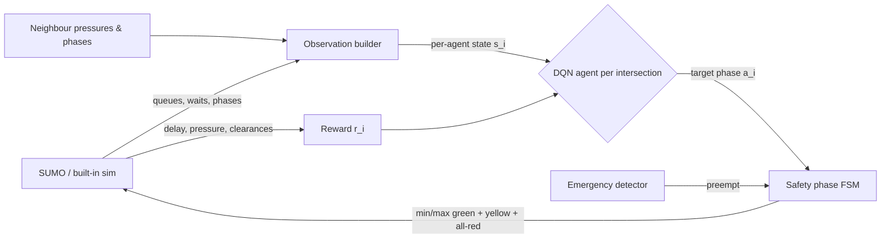

# Adaptive Traffic Signal Control
### Project Report

| | |
|---|---|
| **Author** | Aditya Kumar |

---

## 1. Abstract

Urban intersections are the principal bottlenecks of city road networks. Conventional
fixed-time signals allocate green regardless of the actual traffic on each approach, which
wastes capacity whenever demand is asymmetric or time-varying. This project designs,
implements and evaluates a **multi-agent Deep Reinforcement Learning (DRL) controller** that
adapts signal timing to live traffic on a grid of intersections. Each intersection is an
independent **Double + Dueling DQN** agent with **Prioritized Experience Replay**; agents
observe their neighbours, which lets coordinated *green-wave* progression emerge. The system
runs on the **SUMO** microscopic simulator (with a self-contained fallback simulator), learns
to make way for **emergency vehicles** and adds a preemption rule on top, and is benchmarked
against **fixed-time** and **max-pressure** controllers across five traffic scenarios, one of
them a time-varying surge, on ten seeds each. On identical traffic, the RL controller reduces
average waiting time by **27–71%** versus fixed-time (mean **≈45%**). Against max-pressure it
is level in light and medium traffic and **9% and 17% lower at high and rush demand**, the
only differences beyond seed-to-seed noise. Five independently trained models show how much
of that depends on the training run. An ambulance gets through the grid **~4.4× faster** at
rush hour than under fixed-time.

---

## 2. Problem Statement

Fixed-time signals produce average vehicle waiting times of 50–70 s per intersection under
congestion and cannot react to real-time conditions. The goal is an intelligent controller
that (i) adapts signal phases to live traffic, (ii) is evaluated across multiple densities,
(iii) handles emergency vehicles, and (iv) targets a **40–50% reduction** in waiting time and
queue length versus fixed-time control — reported honestly.

---

## 3. Methodology

### 3.1 System architecture

```
                    ┌──────────────────────────────────────────────────────┐
                    │                    config.yaml                        │
                    │  grid · signal timing · demand · RL hyperparameters   │
                    └───────────────────────────┬──────────────────────────┘
                                                 │
              ┌──────────────────────────────────┼───────────────────────────────┐
              ▼                                   ▼                                ▼
   ┌────────────────────┐          ┌──────────────────────────┐      ┌────────────────────┐
   │  Simulation layer  │          │   Multi-agent RL env      │      │    Controllers     │
   │  ───────────────   │  state   │   ────────────────────    │ obs  │  ───────────────   │
   │  SUMO backend  ◄───┼─────────►│  PettingZoo-style Parallel│─────►│  Fixed-time        │
   │  (TraCI/libsumo)   │  green   │  · per-agent observation  │ act  │  Max-pressure      │
   │  Built-in backend  │◄─────────│  · reward shaping         │◄─────│  RL (DQN)          │
   │  (NumPy fallback)  │          │  · safety phase FSM       │      │  + Emergency preempt│
   └────────────────────┘          └───────────┬──────────────┘      └────────────────────┘
                                                │
                        ┌───────────────────────┼────────────────────────┐
                        ▼                        ▼                        ▼
              ┌──────────────────┐   ┌────────────────────┐   ┌────────────────────┐
              │  Training        │   │  Evaluation        │   │  Live dashboard    │
              │  curriculum +    │   │  RL vs fixed vs    │   │  RL vs fixed race, │
              │  PER + target net│   │  max-pressure, CSV │   │  KPIs, controls,   │
              │  → checkpoint    │   │  + plots           │   │  emergency inject  │
              └──────────────────┘   └────────────────────┘   └────────────────────┘
```

### 3.2 Data / control flow (one decision)



### 3.3 Microscopic network

The default network is a **2×2 grid** (configurable to N×N) of signalised intersections
connected by 200 m bidirectional links, with boundary source/sink edges. Vehicles are
generated by a Poisson process on each boundary approach. Demand is deliberately
**asymmetric** — the East–West arterial carries ≈2.2× the side-street demand — so that a
controller which merely splits green equally (fixed-time) is provably sub-optimal and
adaptivity is genuinely rewarded.

---

## 4. Reinforcement-Learning Formulation

We model each intersection *i* as an agent in a **Partially-Observable Markov Game**
(one shared, homogeneous policy; decentralised execution).

### 4.1 State  `s_i ∈ ℝ^33` (2×2 grid, 2-phase scheme)

| Component | Dim | Description |
|---|---:|---|
| Queue length per approach (N,E,S,W) | 4 | halted vehicles / normaliser (20) |
| Cumulative waiting time per approach | 4 | Σ accumulated wait / normaliser (100 s) |
| Current phase (one-hot) | 2 | active green phase |
| Green time elapsed | 1 | seconds since phase start / max-green |
| Emergency flag per approach | 4 | 1 while an emergency vehicle waits on the approach, 0.5 while one is on its way to it (`rl.emergency_lookahead`) |
| **Neighbour pressure** (N,E,S,W) | 4 | tanh(neighbour pressure / 40) — coordination |
| **Neighbour phase** (N,E,S,W) | 4 | neighbour's active phase index |
| **Per-phase pressure** | 2 | tanh(pressure of the phase / 20): the queue on the approaches the phase serves minus the queues they feed — the quantity the max-pressure rule compares (`rl.pressure_obs`) |
| **Arrival rate** per approach | 4 | vehicles/s joining the approach, averaged over ≈30 s, / 0.5 (`rl.demand_obs`) |
| **Arrival trend** per approach | 4 | the 30 s rate minus the 120 s rate, / 0.2, clipped to ±1: positive while demand is building (`rl.demand_obs`) |

The 8 neighbour features (toggled by `rl.neighbor_obs`) are what allow **green-wave**
coordination to emerge without a central controller. The last 10 features were added to give
the agent what max-pressure sees and an estimate of demand a detector on each approach could
provide; §6.5 measures what each of them buys.

### 4.2 Action  `a_i ∈ {0, …, P−1}`

A **discrete** choice of the next green phase (P = 2 for the NS/EW scheme, 4 for the quad
scheme). The agent only *requests* a phase; a safety finite-state machine realises it while
enforcing **minimum green (10 s), maximum green (60 s), mandatory yellow (3 s) and all-red
clearance (2 s)**. Conflicting movements can therefore never be green simultaneously — this is
guaranteed by construction and verified by unit tests, not learned.

### 4.3 Reward  `r_i`

For agent *i* over one decision interval (5 s):

```
r_i = − w_wait · (Δ_i / N)  −  w_pressure · (P_i / N)  −  w_switch · 1[switched_i]
      + w_emergency · c_i   −  w_emergency_wait · h_i
```

| Symbol | Meaning | Value |
|---|---|---:|
| `Δ_i` | vehicle-seconds of delay accrued at *i* during the interval | — |
| `P_i` | max-pressure quantity = Σ(incoming queue) − ½ Σ(downstream queue) | — |
| `1[switched_i]` | 1 if a phase change was initiated (anti-flicker penalty) | — |
| `c_i` | number of emergency vehicles that crossed *i* during the interval | — |
| `h_i` | emergency vehicles held at *i*, averaged over the interval | — |
| `N` | reward normaliser | 40 |
| `w_wait, w_pressure, w_switch` | weights | 1.0, 0.30, 0.20 |
| `w_emergency, w_emergency_wait` | weights | 10.0, 6.0 |

Minimising delay and pressure reduces congestion; the switch penalty discourages wasteful
flicker. The two emergency terms are live during training: emergency vehicles of a random
type are dispatched on average every 300 s of an episode (`train.emergency_gap_s`), at most
two at a time, **with no preemption rule attached**, so getting them through is left to the
agents. §6.3 measures what the policy learned from that.

### 4.4 Learning algorithm

- **Double DQN** — the online network selects the next action, the target network evaluates
  it, reducing Q-value overestimation.
- **Dueling network** — separate state-value `V(s)` and advantage `A(s,a)` streams,
  recombined as `Q(s,a) = V(s) + (A(s,a) − mean_a A(s,a))`.
- **Prioritized Experience Replay** — transitions sampled ∝ TD-error priority (α = 0.6) with
  importance-sampling correction (β: 0.4 → 1.0).
- **Target network** hard-synced every 500 learner steps; **Huber loss**; **gradient clipping**
  at 10; **ε-greedy** exploration decaying 1.0 → 0.05.
- **Shared parameters** across the homogeneous agents (shared-parameter independent
  Q-learning) with a pooled replay buffer for sample efficiency.
- **Curriculum**: 400 episodes of 1200 s cycling low → medium → high → rush → surge.
- **Time limit**: an episode ends because time is up, not because the traffic ends, so the
  last transition is stored as non-terminal and bootstraps like every other.
- **Model selection during a run**: every 10 episodes the greedy policy is evaluated on
  every curriculum scenario (two fixed seeds each, derived from the training seed and
  distinct from the benchmark's), and the best checkpoint is kept.

> **Implementation note.** The network runs on **PyTorch** when available and transparently
> falls back to an equivalent **from-scratch NumPy** implementation (manual back-propagation +
> Adam) sharing a portable weight format, so training and inference work even where PyTorch
> cannot be installed. The shipped model was trained with PyTorch on one CPU core (about
> eight minutes); the benchmark gives byte-identical results with either network.

---

## 5. Experimental Setup

| Item | Value |
|---|---|
| Network | 2×2 grid, 1 lane/approach, 200 m links |
| Scenarios | low (0.35×), medium (0.60×), high (0.90×), rush (sustained 1.0×), surge (0.60× scaled by a factor that rises from 0.6 to 1.6 at 600 s and falls back, i.e. 0.36× → 0.96× → 0.36×) |
| Baselines | Fixed-time (30 s split) · Max-pressure (throughput-optimal reference) |
| Seeds | 10 identical seeds (0–9) per (controller, scenario) — 150 runs in `outputs/benchmark_results.csv` |
| Episode | 1800 s simulated, 30 s warm-up excluded from metrics |
| Metrics | avg waiting time, avg queue, throughput, avg speed, fuel/CO₂ proxy, emergency clearance |
| Statistics | paired by seed: mean of the per-seed differences with a 95 % Student-t interval |
| Simulator | built-in point-queue model for every headline number; SUMO 1.18 for §6.6 |

All controllers are evaluated on **byte-identical traffic** (same seed → same vehicles), so
every difference is attributable to the control policy alone.

**Models.** The training recipe was run five times (training seeds 42–46). The five models
were compared on the **validation seeds 100–104**, which are neither training traffic nor
benchmark seeds, and the one with the lowest mean waiting time there (seed 45) is the shipped
model. Everything in §6.1–6.3 is that model; §6.4 reports all five.

---

## 6. Results

### 6.1 Waiting time (s per vehicle, mean over ten seeds)

| Scenario | Fixed | Max-Pressure | **RL** | **RL vs Fixed** | RL − Fixed (95 % CI) | **RL vs Max-Pressure** | RL − Max-Pressure (95 % CI) | RL lower in |
|---|---:|---:|---:|---:|---:|---:|---:|---:|
| Low | 26.0 | 18.3 | 19.0 | **−27.2%** | −7.1 ± 0.6 | +3.4% | +0.6 ± 0.7 | 2 of 10 |
| Medium | 33.9 | 22.7 | 22.8 | **−32.6%** | −11.0 ± 0.9 | +0.4% | +0.1 ± 0.9 | 6 of 10 |
| High | 70.1 | 33.9 | 30.9 | **−56.0%** | −39.2 ± 8.7 | **−8.9%** | −3.0 ± 1.2 | 10 of 10 |
| Rush | 122.8 | 43.3 | 36.0 | **−70.7%** | −86.8 ± 10.6 | **−16.9%** | −7.3 ± 2.7 | 10 of 10 |
| Surge | 40.6 | 25.8 | 25.1 | **−38.2%** | −15.5 ± 2.3 | −2.9% | −0.7 ± 0.9 | 7 of 10 |
| **Mean** | | | | **−45.0%** | | | | |

Against fixed-time every difference is far outside its interval. Against max-pressure the
differences at high and rush demand are outside it (RL is lower in every seed); at low,
medium and surge demand the interval includes zero, so those are ties, with max-pressure
nominally ahead at low demand.

### 6.2 Queue length and throughput

| Scenario | Queue (veh/junction): Fixed | Max-Pressure | **RL** | Trips completed: Fixed | Max-Pressure | **RL** |
|---|---:|---:|---:|---:|---:|---:|
| Low | 2.9 | 2.0 | 2.1 | 793 | 794 | 794 |
| Medium | 6.6 | 4.4 | 4.4 | 1368 | 1370 | 1371 |
| High | 20.6 | 9.9 | 9.0 | 2004 | 2056 | 2060 |
| Rush | 40.2 | 14.1 | 11.7 | 2088 | 2276 | 2287 |
| Surge | 7.3 | 4.6 | 4.5 | 1287 | 1287 | 1285 |

### 6.3 Emergency vehicles

**The benchmark's ambulance** (one per episode, east–west) clears the grid in 19.5 s (low),
17.3 s (medium), 26.0 s (high), 29.2 s (rush) and 24.8 s (surge) under RL, against 25.4, 28.9,
72.3, 106.1 and 63.7 s under fixed-time: 1.3× to 3.6× faster.

**Every type, many dispatches.** `tools/emergency_eval.py` sends one vehicle of each type at
25 moments of each of 50 episodes (five scenarios × seeds 0–9), each into its own copy of the
running simulation, under both controllers — 1,250 matched dispatches per type
(`outputs/emergency/`). Three set-ups are compared: fixed-time with stop-line preemption (a
junction switches once the vehicle waits at it); the RL agents with **no rule at all**; and
the shipped set-up, the RL agents plus a green corridor (every junction still ahead of the
vehicle requests its phase from the moment it is sent). All requests go through the safety
FSM, so yellow and all-red are never skipped. Travel time through the grid, pooled:

| Vehicle (corridor) | Fixed-time, stop-line rule | RL, no rule | **RL + corridor** | Waiting time, Fixed → RL + corridor | Stops | RL + corridor faster / tie / slower |
|---|---:|---:|---:|---:|---:|---:|
| Ambulance (EW) | 60.1 s | 26.7 s (−55.6%) | **23.8 s** (−60.5%) | 48.1 → 11.8 s | 1.79 → 1.37 | 88 / 4 / 9% |
| Police car (NS) | 24.8 s | 25.4 s (+2.3%) | **21.6 s** (−13.0%) | 13.8 → 10.6 s | 1.46 → 1.31 | 59 / 10 / 31% |
| Fire engine (EW) | 62.3 s | 28.5 s (−54.2%) | **25.7 s** (−58.7%) | 49.3 → 12.7 s | 1.81 → 1.50 | 88 / 3 / 10% |

By scenario, travel time in seconds (fixed-time / RL with no rule / RL + corridor):

| Vehicle | Low | Medium | High | Rush | Surge |
|---|---:|---:|---:|---:|---:|
| Ambulance | 26.2 / 20.5 / 19.8 | 31.8 / 23.2 / 21.5 | 75.8 / 31.0 / 26.6 | 128.6 / 35.1 / 28.9 | 38.1 / 23.7 / 22.1 |
| Police car | 22.2 / 23.4 / 19.8 | 23.7 / 23.1 / 20.4 | 26.7 / 27.8 / 22.9 | 27.2 / 28.3 / 23.5 | 24.1 / 24.2 / 21.3 |
| Fire engine | 27.7 / 22.2 / 21.5 | 33.6 / 24.9 / 23.1 | 78.5 / 33.0 / 28.7 | 131.4 / 37.2 / 31.6 | 40.1 / 25.4 / 23.7 |

What the policy learned: on the arterial, the agents alone get the ambulance and the fire
engine through in less than half of fixed-time's time, within about 3 s of what the corridor
rule achieves. On the side street they do not: the police car is slightly slower than under
fixed-time without the rule (four of five scenarios), because the agents give the side street
less green than fixed-time's even split. With the corridor every type is faster under RL in
every scenario (the pass condition of the evaluation); for the police car that lead is the
rule's, and it depends on the grids being pre-empted differently (§8, item 5).

### 6.4 How much depends on the training run

The same recipe, five training seeds, on the benchmark seeds
(`outputs/study/model_study.md`, `python tools/model_study.py`):

| Waiting time (s) | Low | Medium | High | Rush | Surge | Mean |
|---|---:|---:|---:|---:|---:|---:|
| Fixed-time | 26.0 | 33.9 | 70.1 | 122.8 | 40.6 | 58.7 |
| Max-pressure | 18.3 | 22.7 | 33.9 | 43.3 | 25.8 | 28.8 |
| RL, training seed 42 | 22.5 | 26.1 | 33.6 | 38.8 | 28.5 | 29.9 |
| RL, training seed 43 | 20.0 | 24.1 | 33.6 | 40.7 | 26.4 | 29.0 |
| RL, training seed 44 | 20.8 | 23.7 | 32.8 | 37.6 | 26.4 | 28.2 |
| RL, training seed 45 (shipped) | 19.0 | 22.8 | 30.9 | 36.0 | 25.1 | 26.7 |
| RL, training seed 46 | 22.7 | 22.3 | 30.7 | 36.5 | 25.1 | 27.5 |
| **RL, mean of the five** | 21.0 | 23.8 | 32.3 | 37.9 | 26.3 | 28.3 |
| RL, standard deviation | 1.6 | 1.4 | 1.4 | 1.9 | 1.4 | 1.2 |
| Models below max-pressure | 0 of 5 | 1 of 5 | 5 of 5 | 5 of 5 | 2 of 5 | 3 of 5 |

On the validation seeds the five models rank almost the same way (means 29.7, 28.2, 28.2, **26.7**,
27.3 s for seeds 42–46, against 29.1 s for max-pressure), which is why seed 45 is shipped. The
finding that survives every retrain is the one under congestion: all five models are below
max-pressure at high and rush demand. At low demand none of the five beats max-pressure, and
the average retrain is 2.7 s behind it.

### 6.5 Ablation

Three more models, each trained with seed 42 and one ingredient removed, compared with the
full seed-42 model on the benchmark seeds (difference in seconds; one training run each):

| Removed | Low | Medium | High | Rush | Surge | Mean |
|---|---:|---:|---:|---:|---:|---:|
| Per-phase pressure inputs | +2.3 | −1.8 | −0.5 | −0.6 | −0.5 | −0.2 |
| Demand inputs (rate and trend) | +4.6 | +3.9 | +3.4 | +4.3 | +4.5 | +4.1 |
| Emergency vehicles in training | −1.9 | −1.0 | +1.4 | +0.2 | −0.5 | −0.4 |

Read against the 1.2–1.9 s standard deviation between retrains: the demand inputs clearly
matter, at every demand level and not only in the surge. The per-phase pressure inputs do
not show a reliable effect (they may help at low demand, +2.3 s without them, but that is
within two standard deviations of one retrain). Training with emergency vehicles costs
nothing measurable in waiting time; what it buys is §6.3.

### 6.6 The same benchmark on SUMO

`python run.py eval --backend sumo` repeats the 150 runs on SUMO 1.18 (libsumo) with the
shipped model, which was trained on the built-in simulator only
(`outputs/sumo/benchmark_summary.md`):

| Scenario | Fixed | Max-Pressure | **RL** | RL − Max-Pressure (95 % CI) | Trips completed: Fixed / Max-Pressure / RL |
|---|---:|---:|---:|---:|---:|
| Low | 21.1 | 14.5 | **11.7** | −2.8 ± 0.9 | 781 / 783 / 785 |
| Medium | 26.4 | 25.4 | **15.1** | −10.3 ± 2.3 | 1336 / 1327 / 1344 |
| High | 45.3 | 37.9 | **22.1** | −15.8 ± 1.4 | 1949 / 1949 / 2012 |
| Rush | 53.9 | 43.1 | **25.5** | −17.6 ± 1.4 | 2062 / 2113 / 2233 |
| Surge | 30.5 | 27.6 | **16.8** | −10.8 ± 1.0 | 1262 / 1264 / 1265 |

The policy transfers to the microscopic simulator without retraining and is ahead of both
baselines in every scenario and seed. This is a second simulator, not a validation against
real traffic, and it should be read with three reservations: SUMO's waiting time is time
standing still and leaves out vehicles that cannot yet enter a full entry road (which makes
the baselines look better than they are, not the agents); max-pressure is used as written,
switching whenever the other phase has more pressure, which costs acceleration time on SUMO
that the point-queue model does not charge; and SUMO is not part of CI (two runs here gave
identical files). The emergency-clearance column of the SUMO summary comes from one ambulance
per episode and was not analysed further.

### 6.7 Figures (generated in `outputs/`)

- `comparison_kpis.png` — waiting time / queue / throughput, all controllers × scenarios.
- `rl_improvement.png` — RL % improvement over fixed-time with the 40–50% target band.
- `emergency_clearance.png` — clearance time by controller.
- `emergency/emergency_<type>.png` — each emergency type, RL against fixed-time on travel time,
  waiting time, stops and time to clear a junction (`python tools/emergency_eval.py`).
- `training_curve.png` — waiting time vs training episode.
- `docs/assets/results.svg` — the chart of the README (`python tools/make_results_svg.py`).

### 6.8 Alignment with the proposal

The proposal targeted a **40–50% reduction** in waiting time and queue length against
fixed-time. The RL controller exceeds it at high and rush demand (56% and 71%), is just under
it in the surge (38%) and medium (33%) scenarios and below it at low demand (27%), where there
is little congestion to remove; the mean over the five scenarios is **45%**. The fixed-time
baseline is close to saturation at high and rush demand, so the large percentages there are
partly the baseline's. The comparison that says more about the learned policy is the one with
max-pressure: level in light traffic, 9% and 17% lower under congestion.

---

## 7. Discussion

- **Where learning pays.** Max-pressure is myopic: it serves whichever phase has more
  pressure now, and pays a 5 s clearance each time that changes. The agents switch less
  often — at rush hour about 66 phase changes per junction in a 30-minute episode against
  max-pressure's 90 — so less green is spent on clearances, which matters most when the
  junction is near capacity.
  In light traffic there is little to plan for, and a rule that simply serves the longer
  queue is hard to beat.
- **Demand inputs.** The ablation's clearest result is that the arrival rate and its trend
  are worth about 4 s at every demand level: knowing how fast an approach is filling is
  useful information even when demand is stationary.
- **Coordination emerges.** With neighbour observations enabled, adjacent intersections
  tend to align their arterial greens. The live dashboard shows the phases of all four
  junctions side by side; a strict green-wave proof would need platoon-level trajectories,
  which the point-queue simulator does not produce.
- **Safety is structural, not learned.** Because the phase FSM enforces yellow + all-red
  clearance on every change, no learned policy — however exploratory — can command a
  conflicting green. This separates *optimisation* (the agent) from *safety* (the
  environment). A change that has begun always completes (a request made during the clearance
  is acted on from the next green), every green lasts between `min_green_s` and
  `max_green_s`, and no phase waits more than `max_green_s` plus two clearances (70 s) for
  its green; `tests/test_phases_safety.py` checks each of these.
- **Emergency vehicles: learned on the arterial, ruled on the side street.** The reward terms
  and the look-ahead flags are enough for the agents to open the arterial for an ambulance by
  themselves. They are not enough to make the agents give up arterial green for a police car
  on the side street; the corridor rule does that.
- **Honest baselines.** Fixed-time uses a standard 30 s split (not crippled); max-pressure is
  a strong, throughput-optimal reference, and it is the one the conclusions are drawn against.

---

## 8. Limitations

1. **Light traffic.** At low and medium demand the shipped model only matches max-pressure,
   and it is the best of five trained models there; the average retrain is 2.7 s (low) and
   1.1 s (medium) behind max-pressure.
2. **A selected model.** The shipped model was chosen among five on validation seeds. That is
   ordinary model selection and the benchmark seeds were not used for it, but the spread
   between retrains (standard deviation 1.2 s on the mean, §6.4) is the error bar that belongs
   to any claim about the *method* rather than about this checkpoint.
3. **Point-queue fidelity and scale.** The built-in simulator is a store-and-forward model
   without lane-changing or spill-back, on a 2×2 grid, and every headline number comes from
   it (`eval.backend: mini`). The SUMO run (§6.6) is encouraging but was not used for training
   or tuning. A 3×3 grid is supported via config but requires a full retrain.
4. **Fixed-time near saturation.** At high and rush demand fixed-time's east–west green can
   discharge about 0.21 vehicles/s against 0.20–0.22 arriving, so its waiting time grows with
   the episode length and the −56% / −71% are partly a property of the baseline.
5. **Pre-emption differs between the grids, and the police car depends on it.** The RL grid
   clears a green corridor along the emergency vehicle's route; fixed-time and max-pressure
   pre-empt a junction once the vehicle is queued at it (`emergency.corridor` in
   `config.yaml`). With the same preemption on both grids the police car, on the side street,
   is slower under RL — by 1.4% with stop-line preemption on both, by 9.9% with a corridor on
   both — and with no rule on the RL grid it is 2.3% slower than fixed-time. With the corridor
   on the RL grid only it is 13.0% faster on average, and fixed-time still gets it through
   first in 31% of the dispatches. The point-queue model also lets an emergency vehicle wait
   behind the queue ahead of it.
6. **Training reproducibility.** Retraining is repeatable on one machine and library stack
   but not across NumPy / PyTorch builds; the published results come from the shipped
   checkpoints, from which `run.py eval`, `tools/emergency_eval.py` and `tools/model_study.py`
   regenerate them exactly.
7. **One surge shape.** The time-varying scenario is a single Gaussian peak at a fixed time,
   and it is part of the training curriculum; surges of other shapes or timings were not
   tested.

---

## 9. Future Work

- **Closing the light-traffic gap** — for example a longer or better-tuned training run, or a
  recurrent state (GRU) in place of the two running averages of the demand inputs.
- **Other demand profiles** — several peaks, incidents, a peak the policy was not trained on.
- **Training on SUMO**, now that the policy has been shown to transfer to it.
- **CTDE upgrade** — the repository already includes a config-gated **QMIX** learner
  (`qmix.enabled: true`) for centralised-training / decentralised-execution coordination.
- **Real-map import** via OSM for an actual Bengaluru junction.
- **Vision-based demand** — a camera/YOLO vehicle-count front end (future-work stub).
- **Towards the field** — a hardware signal controller would need a conflict monitor, mains
  lamps and a standard communication protocol (NTCIP/UTMC), with real detectors feeding the
  observations and the policy running on the controller itself.
- **Larger grids and heterogeneous intersections** (turn lanes, protected phases).

---

## 10. Conclusion

The project delivers a complete, runnable multi-agent DRL traffic-signal controller that
adapts to live traffic, coordinates across intersections, makes way for emergency vehicles
and is benchmarked against fixed-time and max-pressure baselines across five scenarios, ten
seeds each, with confidence intervals, five independently trained models, an ablation and a
run on SUMO. Against fixed-time it reaches the proposal's **40–50% waiting-time and queue
reduction** target on average (**45%**) and exceeds it under congestion (**56%** at high,
**71%** at rush demand). Against max-pressure, the stronger baseline, the result is narrower
and is stated as such: **equal in light traffic, 9–17% better under congestion**, the latter
in every seed and for every retrained model. It ships with a real-time dashboard for live
demonstration.

---

## References

1. S. Agrawal, R. Sharma, P. Srivastava, V. Patel, "Adaptive Traffic Signal Control System Using Deep Reinforcement Learning," *IEEE INSPECT*, 2024. doi:10.1109/INSPECT63485.2024.10896157
2. X. Mei et al., "Reinforcement Learning Based Traffic Signal Control Considering Railway Information in Japan," *IEEE ITSC*, 2023. doi:10.1109/ITSC57777.2023.10422232
3. M. T. Rafique, A. Mustafa, H. Sajid, "Deep Reinforcement Learning for Adaptive Traffic Signal Control," *arXiv:2408.15751*, 2024.
4. B. D. et al., "Real-Time Traffic Signal Optimization Using Deep Reinforcement Learning in SUMO Simulated Environments," *IJIRT*, 12(4):3383–3387, 2025.
5. S. Wang, S. Wang, "A Novel Multi-Agent Deep RL Approach for Traffic Signal Control," *arXiv:2306.02684*, 2023.
6. S. Alemzadeh, R. Moslemi, R. Sharma, M. Mesbahi, "Adaptive Traffic Control with Deep Reinforcement Learning: Towards State-of-the-art and Beyond," *arXiv:2007.10960*, 2020.
7. S. Park et al., "Deep Q-Network-Based Traffic Signal Control Models," *PLOS ONE*, 16(9):e0256405, 2021.
8. M. Zhu, X.-Y. Liu, S. Borst, A. Walid, "Deep Reinforcement Learning for Traffic Light Control in Intelligent Transportation Systems," *IEEE Trans. Network Science and Engineering*, 2025.

*Additional methods:* van Hasselt et al. (Double DQN, AAAI 2016); Wang et al. (Dueling
Networks, ICML 2016); Schaul et al. (Prioritized Experience Replay, ICLR 2016); Varaiya
(Max-pressure control, Transportation Research Part C, 2013); Rashid et al. (QMIX, ICML 2018).
