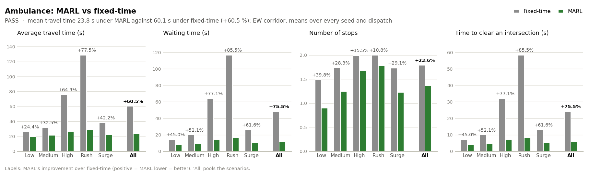
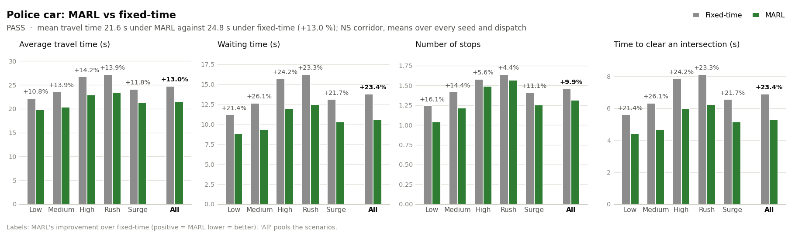
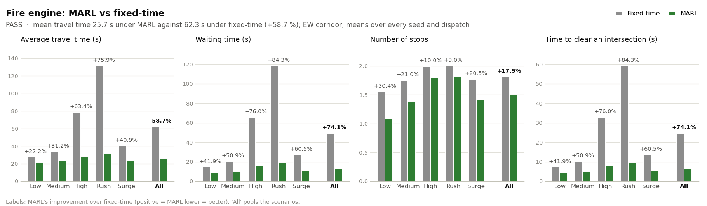

# Emergency vehicles: MARL vs fixed-time

Built-in simulator, 5 scenario(s) (low, medium, high, rush, surge) x 10 seeds (0, 1, 2, 3, 4, 5, 6, 7, 8, 9) x 25 dispatch times (60 s to 1620 s, every 65 s) = 1250 matched dispatches per vehicle type. Each dispatch sends one vehicle of each type into its own copy of the running simulation, under each controller, so every vehicle meets the traffic its controller has built up and no other emergency vehicle. `emergency_dispatches.csv` next to this file has every dispatch.

Preemption, as in the benchmark and the dashboard (`emergency.corridor` in `config.yaml`): MARL - green corridor along the route; Fixed-time - stop-line preemption.

Improvement = (fixed-time − MARL) / fixed-time: positive means MARL is lower, which is better for every metric here.

## Results (all scenarios pooled)

| Vehicle type | Metric | Fixed-time | MARL | Improvement |
|:--|:--|--:|--:|--:|
| **Ambulance** | Average travel time | 60.1 s | 23.8 s | +60.5 % |
|  | Waiting time | 48.1 s | 11.8 s | +75.5 % |
|  | Number of stops | 1.79 | 1.37 | +23.6 % |
|  | Time to clear an intersection | 24.1 s | 5.9 s | +75.5 % |
| **Police car** | Average travel time | 24.8 s | 21.6 s | +13.0 % |
|  | Waiting time | 13.8 s | 10.6 s | +23.4 % |
|  | Number of stops | 1.46 | 1.31 | +9.9 % |
|  | Time to clear an intersection | 6.9 s | 5.3 s | +23.4 % |
| **Fire engine** | Average travel time | 62.3 s | 25.7 s | +58.7 % |
|  | Waiting time | 49.3 s | 12.7 s | +74.1 % |
|  | Number of stops | 1.81 | 1.50 | +17.5 % |
|  | Time to clear an intersection | 24.6 s | 6.4 s | +74.1 % |

## Pass / fail

Pass condition: every emergency vehicle type has a lower average travel time under MARL than under fixed-time.

| Vehicle type | Corridor | Travel time, fixed-time | Travel time, MARL | Improvement | Lower under MARL in | MARL faster / tie / slower | Result |
|:--|:--|--:|--:|--:|--:|--:|:--|
| Ambulance | EW | 60.1 s | 23.8 s | +60.5 % | 5 of 5 scenarios | 88 / 4 / 9 % | **PASS** |
| Police car | NS | 24.8 s | 21.6 s | +13.0 % | 5 of 5 scenarios | 59 / 10 / 31 % | **PASS** |
| Fire engine | EW | 62.3 s | 25.7 s | +58.7 % | 5 of 5 scenarios | 88 / 3 / 10 % | **PASS** |

Overall: **PASS**

*MARL faster / tie / slower* is the share of matched dispatches in which the vehicle got through the MARL grid sooner, at the same second, or later.

## The agents on their own

Emergency vehicles are part of training, so the agents react to them without any rule: an approach's emergency flag in the observation shows a vehicle waiting on it or still on its way to it, and the reward charges for every decision one is kept waiting. This table takes the preemption rule away from the MARL grid and leaves fixed-time its stop-line preemption. It is not part of the pass condition.

| Vehicle type | Scenario | Fixed-time, stop-line rule | MARL, no rule | Improvement | MARL with the corridor rule |
|---|---|---:|---:|---:|---:|
| Ambulance | **all** | 60.1 s | 26.7 s | +55.6 % | 23.8 s |
| Ambulance | low | 26.2 s | 20.5 s | +21.7 % | 19.8 s |
| Ambulance | medium | 31.8 s | 23.2 s | +27.1 % | 21.5 s |
| Ambulance | high | 75.8 s | 31.0 s | +59.2 % | 26.6 s |
| Ambulance | rush | 128.6 s | 35.1 s | +72.7 % | 28.9 s |
| Ambulance | surge | 38.1 s | 23.7 s | +37.8 % | 22.1 s |
| Police car | **all** | 24.8 s | 25.4 s | −2.3 % | 21.6 s |
| Police car | low | 22.2 s | 23.4 s | −5.2 % | 19.8 s |
| Police car | medium | 23.7 s | 23.1 s | +2.5 % | 20.4 s |
| Police car | high | 26.7 s | 27.8 s | −4.2 % | 22.9 s |
| Police car | rush | 27.2 s | 28.3 s | −3.9 % | 23.5 s |
| Police car | surge | 24.1 s | 24.2 s | −0.4 % | 21.3 s |
| Fire engine | **all** | 62.3 s | 28.5 s | +54.2 % | 25.7 s |
| Fire engine | low | 27.7 s | 22.2 s | +19.7 % | 21.5 s |
| Fire engine | medium | 33.6 s | 24.9 s | +25.9 % | 23.1 s |
| Fire engine | high | 78.5 s | 33.0 s | +58.0 % | 28.7 s |
| Fire engine | rush | 131.4 s | 37.2 s | +71.7 % | 31.6 s |
| Fire engine | surge | 40.1 s | 25.4 s | +36.8 % | 23.7 s |

## Charts

## By scenario

### Ambulance (EW corridor, speed factor 1.30)

| Scenario | Metric | Fixed-time | MARL | Improvement |
|:--|:--|--:|--:|--:|
| low | Average travel time | 26.2 s | 19.8 s | +24.4 % |
|  | Waiting time | 14.2 s | 7.8 s | +45.0 % |
|  | Number of stops | 1.49 | 0.90 | +39.8 % |
|  | Time to clear an intersection | 7.1 s | 3.9 s | +45.0 % |
| medium | Average travel time | 31.8 s | 21.5 s | +32.5 % |
|  | Waiting time | 19.8 s | 9.5 s | +52.1 % |
|  | Number of stops | 1.74 | 1.24 | +28.3 % |
|  | Time to clear an intersection | 9.9 s | 4.7 s | +52.1 % |
| high | Average travel time | 75.8 s | 26.6 s | +64.9 % |
|  | Waiting time | 63.8 s | 14.6 s | +77.1 % |
|  | Number of stops | 1.99 | 1.68 | +15.5 % |
|  | Time to clear an intersection | 31.9 s | 7.3 s | +77.1 % |
| rush | Average travel time | 128.6 s | 28.9 s | +77.5 % |
|  | Waiting time | 116.6 s | 16.9 s | +85.5 % |
|  | Number of stops | 2.00 | 1.78 | +10.8 % |
|  | Time to clear an intersection | 58.3 s | 8.4 s | +85.5 % |
| surge | Average travel time | 38.1 s | 22.1 s | +42.2 % |
|  | Waiting time | 26.1 s | 10.1 s | +61.6 % |
|  | Number of stops | 1.73 | 1.23 | +29.1 % |
|  | Time to clear an intersection | 13.1 s | 5.0 s | +61.6 % |

| Scenario | Matched dispatches | MARL faster | Tie | Fixed-time faster | Seeds where MARL's mean is lower | 95 % CI of the gain over seeds |
|:--|--:|--:|--:|--:|--:|--:|
| **all** | 1250 | 88 % | 4 % | 9 % | 50 / 50 | +36.4 ± 11.4 s |
| low | 250 | 72 % | 10 % | 19 % | 10 / 10 | +6.4 ± 0.9 s |
| medium | 250 | 81 % | 5 % | 14 % | 10 / 10 | +10.3 ± 1.5 s |
| high | 250 | 100 % | 0 % | 0 % | 10 / 10 | +49.2 ± 12.8 s |
| rush | 250 | 100 % | 0 % | 0 % | 10 / 10 | +99.8 ± 32.5 s |
| surge | 250 | 86 % | 3 % | 11 % | 10 / 10 | +16.1 ± 3.6 s |

### Police car (NS corridor, speed factor 1.40)

| Scenario | Metric | Fixed-time | MARL | Improvement |
|:--|:--|--:|--:|--:|
| low | Average travel time | 22.2 s | 19.8 s | +10.8 % |
|  | Waiting time | 11.2 s | 8.8 s | +21.4 % |
|  | Number of stops | 1.24 | 1.04 | +16.1 % |
|  | Time to clear an intersection | 5.6 s | 4.4 s | +21.4 % |
| medium | Average travel time | 23.7 s | 20.4 s | +13.9 % |
|  | Waiting time | 12.7 s | 9.4 s | +26.1 % |
|  | Number of stops | 1.42 | 1.21 | +14.4 % |
|  | Time to clear an intersection | 6.3 s | 4.7 s | +26.1 % |
| high | Average travel time | 26.7 s | 22.9 s | +14.2 % |
|  | Waiting time | 15.7 s | 11.9 s | +24.2 % |
|  | Number of stops | 1.58 | 1.49 | +5.6 % |
|  | Time to clear an intersection | 7.9 s | 6.0 s | +24.2 % |
| rush | Average travel time | 27.2 s | 23.5 s | +13.9 % |
|  | Waiting time | 16.2 s | 12.5 s | +23.3 % |
|  | Number of stops | 1.64 | 1.57 | +4.4 % |
|  | Time to clear an intersection | 8.1 s | 6.2 s | +23.3 % |
| surge | Average travel time | 24.1 s | 21.3 s | +11.8 % |
|  | Waiting time | 13.1 s | 10.3 s | +21.7 % |
|  | Number of stops | 1.41 | 1.25 | +11.1 % |
|  | Time to clear an intersection | 6.6 s | 5.1 s | +21.7 % |

| Scenario | Matched dispatches | MARL faster | Tie | Fixed-time faster | Seeds where MARL's mean is lower | 95 % CI of the gain over seeds |
|:--|--:|--:|--:|--:|--:|--:|
| **all** | 1250 | 59 % | 10 % | 31 % | 50 / 50 | +3.2 ± 0.3 s |
| low | 250 | 52 % | 16 % | 32 % | 10 / 10 | +2.4 ± 0.5 s |
| medium | 250 | 62 % | 9 % | 30 % | 10 / 10 | +3.3 ± 0.7 s |
| high | 250 | 64 % | 7 % | 29 % | 10 / 10 | +3.8 ± 0.6 s |
| rush | 250 | 62 % | 7 % | 32 % | 10 / 10 | +3.8 ± 1.0 s |
| surge | 250 | 58 % | 12 % | 30 % | 10 / 10 | +2.8 ± 0.6 s |

### Fire engine (EW corridor, speed factor 1.15)

| Scenario | Metric | Fixed-time | MARL | Improvement |
|:--|:--|--:|--:|--:|
| low | Average travel time | 27.7 s | 21.5 s | +22.2 % |
|  | Waiting time | 14.7 s | 8.5 s | +41.9 % |
|  | Number of stops | 1.55 | 1.08 | +30.4 % |
|  | Time to clear an intersection | 7.3 s | 4.3 s | +41.9 % |
| medium | Average travel time | 33.6 s | 23.1 s | +31.2 % |
|  | Waiting time | 20.6 s | 10.1 s | +50.9 % |
|  | Number of stops | 1.75 | 1.38 | +21.0 % |
|  | Time to clear an intersection | 10.3 s | 5.1 s | +50.9 % |
| high | Average travel time | 78.5 s | 28.7 s | +63.4 % |
|  | Waiting time | 65.5 s | 15.7 s | +76.0 % |
|  | Number of stops | 1.99 | 1.79 | +10.0 % |
|  | Time to clear an intersection | 32.8 s | 7.9 s | +76.0 % |
| rush | Average travel time | 131.4 s | 31.6 s | +75.9 % |
|  | Waiting time | 118.4 s | 18.6 s | +84.3 % |
|  | Number of stops | 2.00 | 1.82 | +9.0 % |
|  | Time to clear an intersection | 59.2 s | 9.3 s | +84.3 % |
| surge | Average travel time | 40.1 s | 23.7 s | +40.9 % |
|  | Waiting time | 27.1 s | 10.7 s | +60.5 % |
|  | Number of stops | 1.77 | 1.41 | +20.5 % |
|  | Time to clear an intersection | 13.6 s | 5.4 s | +60.5 % |

| Scenario | Matched dispatches | MARL faster | Tie | Fixed-time faster | Seeds where MARL's mean is lower | 95 % CI of the gain over seeds |
|:--|--:|--:|--:|--:|--:|--:|
| **all** | 1250 | 88 % | 3 % | 10 % | 50 / 50 | +36.5 ± 11.4 s |
| low | 250 | 71 % | 7 % | 22 % | 10 / 10 | +6.1 ± 0.9 s |
| medium | 250 | 82 % | 4 % | 14 % | 10 / 10 | +10.5 ± 1.5 s |
| high | 250 | 99 % | 0 % | 1 % | 10 / 10 | +49.8 ± 13.0 s |
| rush | 250 | 100 % | 0 % | 0 % | 10 / 10 | +99.7 ± 31.9 s |
| surge | 250 | 86 % | 2 % | 11 % | 10 / 10 | +16.4 ± 3.7 s |

## Metric definitions

- **Average travel time**: from dispatch (the vehicle enters the grid at the back of the entry queue) until it crosses the last junction on its route; this is the project's `emergency_clearance_time` and is read back from the simulator.
- **Waiting time**: seconds the vehicle spent held at stop lines (the simulator's own waiting-time count). Travel time = waiting time + the free-flow drive along the link between the junctions.
- **Number of stops**: junctions at which the vehicle was held longer than the 1 s the point-queue model needs to cross an empty approach on green.
- **Time to clear an intersection**: from reaching a junction's stop line to crossing it, averaged over the junctions on the route (2 on the 2 x 2 grid).
- **95 % CI of the gain over seeds**: fixed-time's minus MARL's mean travel time, with a 95 % t-interval over the per-seed means (per scenario and seed for **all**).
